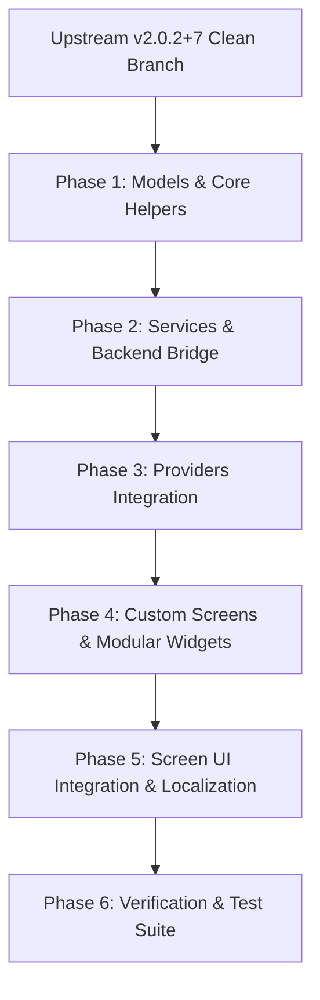

# Musly Upgrade & Upstream Comparison Report

> **Target Version:** Upstream `https://github.com/dddevid/Musly` (v2.0.2+7 / commit `44ff278`)  
> **Current Fork Baseline:** `git@github.com:atoffano/Musly.git` (v1.0.8 / commit `c5ba9af` + 65 fork commits)  
> **Date:** October 2026  
> **Scope:** Architecture comparison, fork feature preservation, upgrade feasibility, and staged migration plan.

---

## 1. Executive Summary

Musly is the mobile/desktop Flutter client for self-hosted music streaming. In this workspace (`docker/music-pipeline/Musly`), Musly operates as a customized frontend tightly coupled to the **`music-pipeline`** FastAPI backend bridge (port 8788), providing YouTube Music search, streaming, beets tagging, Navidrome synchronization, multi-destination scrobbling, and end-to-end Spotify migration.

### Key Findings
1. **Massive Upstream Evolution:** Upstream moved from **v1.0.8** to **v2.0.2+7** across 415 commits (+106,293 additions / -28,360 deletions across 532 files). Upstream introduced Google Cast, UPnP/DLNA remote streaming, Android Auto, Samsung Tizen TV support, SQLite local caching, a Spotify-style desktop redesign, full i18n localization (27 languages), and client-side "Web Stream".
2. **Structural Codebase Reorganization:** Upstream completely dismantled the flat `lib/screens/` and `lib/widgets/` hierarchy, modularizing all screens into category subdirectories (`lib/screens/main/`, `player/`, `media/`, `settings/`, `detail/`, `auth/`) and widgets into (`common/`, `navigation/`, `now_playing/`, `modals/`, `cards/`). Multiple individual screens (`all_songs_screen`, `all_albums_screen`, `new_releases_screen`) were deleted and replaced by unified collection engines (`SongCollectionScreen`, `AlbumCollectionScreen`).
3. **Upgrade Feasibility:**
   - **Can it be upgraded with a direct `git merge upstream/master`?** **NO.** A direct Git merge or automated rebase will trigger fatal `modify/delete` merge conflicts across almost every primary screen and widget, in addition to massive collision conflicts in `player_provider.dart` (+2,899 lines diff) and `library_provider.dart`.
   - **Can the fork be upgraded cleanly while conserving all custom features?** **YES, via a Staged Modular Port.** Because the fork's additions are logically decoupled into dedicated services (`MuslyBackendService`), screens (`SpotifyMigrationScreen`, `PipelineLogsScreen`, `BridgeArtistScreen`, `RecommendationsScreen`), and well-defined provider hooks, these additions can be ported onto Upstream v2.0.2 systematically without regressions.

---

## 2. Upstream Changes (v1.0.8 $\rightarrow$ v2.0.2+)

### 2.1 Core Architectural & Structural Refactoring
- **Directory Hierarchy Modularization (Commit `2201d7cb`):**
  - `lib/screens/main/`: `home_screen.dart`, `library_screen.dart`, `search_screen.dart`, `main_screen.dart`, `library_search_delegate.dart`.
  - `lib/screens/player/`: `now_playing_screen.dart`, `lyrics_screen.dart`, `tv_now_playing_screen.dart`.
  - `lib/screens/media/`: `song_collection_screen.dart`, `album_collection_screen.dart`, `playlists_screen.dart`, `favorites_screen.dart`, `downloads_screen.dart`, `genres_screen.dart`, `jukebox_screen.dart`, `radio_screen.dart`.
  - `lib/screens/settings/`: Dedicated tabs (`settings_server_tab`, `settings_display_tab`, `settings_playback_tab`, `settings_storage_tab`, `settings_about_tab`, `settings_support_tab`).
  - `lib/screens/detail/`: `album_screen.dart`, `artist_screen.dart`, `playlist_screen.dart`, `genre_screen.dart`.
  - `lib/widgets/now_playing/`: The monolithic `NowPlayingScreen` was decomposed into modular widgets (`album_art_view`, `marquee_text`, `now_playing_bottom_actions`, `now_playing_more_menu`, `playback_controls`, `playback_progress_slider`, `queue_view`, `volume_slider`).
  - `lib/widgets/modals/`: `song_options_modal.dart`, `server_switcher_sheet.dart`.
  - `lib/widgets/common/`: `song_tile.dart`, `album_artwork.dart`, `multi_artist_widget.dart`, `media_play_button.dart`, `pill_tab_bar.dart`.
- **Screen Consolidation:** Replaced static lists and separate screens (`all_songs_screen.dart`, `albums_screen.dart`, `liked_albums_screen.dart`, `new_releases_screen.dart`, `top_rated_screen.dart`) with `SongCollectionScreen` and `AlbumCollectionScreen` utilizing lazy virtualized `SliverList.builder` and `SliverGrid.builder`.

### 2.2 Audio Engine & Hardware Streaming
- **`MuslyAudioHandler` (`audio_service: ^0.18.18`):** Comprehensive background audio rewrite supporting platform media controls, lock screen notifications, Android Auto integration, and unified playback parameter synchronization.
- **DLNA / UPnP Remote Streaming (`UpnpService`):** SSDP discovery for all LAN renderers, remote AVTransport playback, track progression synchronization, pre-queuing via `SetNextAVTransportURI`, and hardware volume overlay jump mitigation.
- **Google Cast Integration (`CastService`, `flutter_chrome_cast`):** Device discovery, remote session lifecycle tracking, continuous position/duration synchronization, and seamless track completion auto-advance.
- **Persistent & Reorderable Playback Queue:** Upcoming songs persist across app restarts and can be interactively reordered via `ReorderableListView.builder` connected to `PlayerProvider.reorderQueue()`.
- **Playback Polish:** Smart audio focus fade in/out on external interruptions (e.g. YouTube/Instagram playback), native pitch & tempo controls (`PitchPlugin`), Auto DJ / crossfading (`CrossfadeService`), and ReplayGain volume normalization (`ReplayGainService`).

### 2.3 Server & Storage Ecosystem
- **Jellyfin / Emby Support (`JellyfinService`):** Native playback and synchronization for Jellyfin/Emby servers alongside Subsonic/Navidrome.
- **Local Music Library (`LocalMusicService`):** Playback of songs stored directly on device storage without requiring an active server connection.
- **Multi-Server Profiles:** Store, switch, and reorder multiple Subsonic and Jellyfin server profiles from a dedicated server switcher.
- **Dual LAN / WAN URLs:** Separate Local LAN and Remote WAN server addresses with automated latency checks and seamless fallback.
- **SQLite Database (`sqflite`, `LibraryDatabaseService`):** Persistent local cache for library metadata, fast search indexing, and recommendation candidate pools.
- **Dedicated Offline Downloader:** Batch download playlists, albums, and favorites with file verification and customizable SD card / external storage paths.

### 2.4 Platforms & Form Factors
- **Desktop UI Redesign:** Full 3-column desktop layout (navigation sidebar, content view, right queue sidebar) with window minimum sizing ($800\times 560$), volume level restoration on unmute, and safe global spacebar play/pause handling.
- **Windows System Media Transport Controls (SMTC):** Native Windows media overlay, timeline scrubbing, album art rendering, and Discord Rich Presence integration.
- **Samsung Tizen TV Mode:** Full Samsung Tizen TV support (`tizen/` workspace), TV remote D-Pad navigation (`TvRemoteScope`), and TV-optimized player layouts.
- **Foldables & Tablets:** Responsive dual-column layouts and adaptive safe insets for Samsung Galaxy Z Fold, Google Pixel Fold, Microsoft Surface Duo, and landscape tablets.

### 2.5 UI & Internationalization (i18n)
- **Multi-Language Architecture:** 27 languages powered by Flutter ARB files and automated Crowdin synchronization. Elimination of hardcoded UI strings.
- **Dynamic Theming & Palette Extraction:** Upgraded 3-color palette extraction (`PaletteGenerator`) for fullscreen mesh ambient player backgrounds; full support for Android 13+ Material You dynamic themed icons.
- **Synced Lyrics Customization:** Syllable and line-level synced lyrics via LRCLIB (`LrclibService`), live lyric pill under artwork, and lock-screen lyrics integration.

---

## 3. Current Fork Additions (`atoffano/Musly`)

The current fork contains 65 commits implementing a rich set of capabilities designed to interface with the `music-pipeline` container:

### 3.1 Bridge Integration (`MuslyBackendService`)
- **Location:** `lib/services/musly_backend_service.dart` (584 lines).
- **Functionality:**
  - `GET /health` bridge liveness verification.
  - `GET /api/search?q=...` YouTube Music search proxy.
  - `POST /api/stream` stream URL resolution with rich metadata forwarding.
  - `POST /api/save` non-blocking track ingestion into Navidrome.
  - `GET /api/job/{job_id}` background save job status polling (`queued -> downloading -> imported -> syncing -> ready`).
  - `POST /api/delete` single track and batch track deletion with filesystem unlinking and Navidrome rescanning.
  - `GET /api/logs` structured application logs retrieval.
- **Automatic Bridge Resolution:** `ServerConfig.bridgeUrl` parses the Subsonic server host and targets port `8788`.

### 3.2 YouTube Music Feed & Recommendations
- **`RecommendationsProvider` & `RecommendationsScreen`:**
  - Explores mood/genre categories and curated playlists directly from YouTube Music.
  - Horizontal recommendation category preview chips on `HomeScreen`.
  - Featured playlist cards (Quick Picks, New Releases).
- **`BridgeArtistScreen` (`lib/screens/bridge_artist_screen.dart`):**
  - Renders top tracks and full discographies for artists found via YouTube search that do not yet exist in the local Navidrome library.

### 3.3 Universal Multi-Destination Scrobbling
- **Unified Scrobble Pipeline (`PlayerProvider._performScrobble`):**
  - Triggered at 50% playtime threshold or 4 minutes.
  - Forwards scrobble requests to `POST /api/scrobble` on `music-pipeline`.
  - Records listening history into user's authenticated YouTube Music account (using `browser.json`), Last.fm, ListenBrainz, and Navidrome simultaneously with duplicate suppression.

### 3.4 Spotify Migration Wizard
- **`SpotifyMigrationScreen` (`lib/screens/spotify_migration_screen.dart`, 1,507 lines):**
  - **Fast Route:** Zero-auth public Spotify playlist URL ingestion + 15-second Liked Songs guide.
  - **Full Route:** Dual-dump GDPR account archive ingestion (Account Data ZIP + Extended Streaming History ZIP).
  - Background polling, persistent source registry, cross-navigation state restoration, and live migration logs.

### 3.5 UI Customizations & Library Management
- **Library & Playlist Enhancements (`PlaylistOptionsSheet`):**
  - Duplicate playlist functionality.
  - "Delete Playlist with Songs" batch deletion via bridge.
  - Real "Recently Added" sorting by song creation timestamps (`getSongsAddedDates()`).
- **Album Management:** Long-press album deletion options sheet with batch bridge song deletion in `AllAlbumsScreen` / `LibraryScreen`.
- **Song Tile & Now Playing Actions:**
  - One-tap YouTube save button (plus icon / checkmark) with animated loading spinner.
  - Multi-artist splitting and clickable tags (`MultiArtistWidget`, `ArtistRef.splitArtistString`).
  - Safe source-aware track removal (`removeYouTubeSaved`).
- **Profile Avatar:** 42px `UserProfileAvatar` integrated into Home, Search, and Library app bars.
- **Pipeline Logs Viewer:** `PipelineLogsScreen` for tailing bridge ingestion logs directly in the app.

---

## 4. Architectural Comparison: Fork vs. Upstream

| Capability | Upstream Musly (v2.0.2+) | Fork (atoffano/Musly) | Comparison & Recommendation |
|---|---|---|---|
| **YouTube Streaming** | Client-side via `youtube_explode_dart` & temporary cache (`musly_yt_cache`). | Server-side via `music-pipeline` bridge (`POST /api/stream`). | Fork uses server bridge. Upstream's client-side stream can coexist as "Web Stream", but `music-pipeline` must remain the primary bridge. |
| **Track Ingestion** | None (client-side only stream/cache). | Server-side pipeline: `yt-dlp` $\rightarrow$ `beets` $\rightarrow$ tag/art embedding $\rightarrow$ Navidrome scan. | **Essential to conserve.** Unique to fork. |
| **Scrobbling** | Subsonic native scrobble to server only. | Multi-scrobble via bridge to YouTube History, Last.fm, ListenBrainz, and Navidrome. | **Essential to conserve.** Upstream only scrobbles to Subsonic/Jellyfin. |
| **Artist Discovery** | Only artists present in Subsonic/Jellyfin library. | `BridgeArtistScreen` queries YouTube Music for external artists. | **Essential to conserve.** Enables discovering non-library artists. |
| **Spotify Migration** | None. | Dual-route (URL + GDPR dual-zip) migration wizard. | **Essential to conserve.** Standalone 1500-line screen. |
| **Playback Architecture** | `MuslyAudioHandler` + `CastService` + `UpnpService` + persistent queue. | Extended `PlayerProvider` with `_resolvePlayableUrl` and save state. | Upstream playback architecture is vastly superior. Fork hooks must be integrated into Upstream's `PlayerProvider`. |
| **Library Management** | SQLite `LibraryDatabaseService`, multi-server profiles, Jellyfin. | In-memory cache + bridge batch delete + playlist duplicate. | Both should be unified: SQLite cache + bridge delete fallback. |
| **UI Structure** | Modularized subfolders (`screens/main/`, `widgets/now_playing/`, etc.). | Legacy flat structure (`lib/screens/`, `lib/widgets/`). | **Adopt Upstream's modular layout.** Fork screens must be moved into proper subdirectories. |

---

## 5. Upgrade Conflict Analysis

### 5.1 Why a Naive Git Merge Fails
Running `git merge upstream/master` produces immediate conflicting states:
1. **Modify/Delete Conflicts:**
   - Upstream moved `home_screen.dart`, `library_screen.dart`, `search_screen.dart` into `lib/screens/main/`.
   - Upstream moved `now_playing_screen.dart` into `lib/screens/player/`.
   - Upstream deleted `all_songs_screen.dart` and `all_albums_screen.dart`, replacing them with `song_collection_screen.dart` and `album_collection_screen.dart`.
   - Upstream moved `song_tile.dart` into `lib/widgets/common/song_tile.dart` and `mini_player.dart` into `lib/widgets/navigation/mini_player.dart`.
   - Because the fork modified all of these files in their original locations, Git cannot automatically reconcile the directory refactor with the fork's content edits.
2. **Provider Collisions:**
   - Upstream's `player_provider.dart` changed by 2,899 lines (introduced `MuslyAudioHandler`, Cast, UPnP, AutoDJ). The fork's changes to `_resolvePlayableUrl`, `_performScrobble`, and YouTube save polling conflict on nearly every method boundary.
   - Upstream's `library_provider.dart` shifted to `LibraryDatabaseService` and multi-server architecture.
3. **Localization Breakage:**
   - Upstream converted all screens to ARB localized strings (`AppLocalizations.of(context)`). Merging flat files with hardcoded English strings creates code styling and translation regressions.

---

## 6. Recommended Upgrade Strategy: Staged Modular Port

Instead of attempting a destructive Git merge, the upgrade should be executed as a **clean feature port onto a new branch based on `upstream/master` (v2.0.2+7)**.



### Phase 1: Models & Core Helpers
1. **`lib/models/song.dart`:**
   - Add fork fields: `sourceType`, `sourceId`, `streamUrl`, `saved`.
   - Add getter: `bool get isYouTube => sourceType == 'youtube' || id.startsWith('yt:');`.
   - Update `fromJson`, `toJson`, and `copyWith`.
2. **`lib/models/server_config.dart`:**
   - Add `String? get bridgeUrl` getter (derives port 8788 from `serverUrl`).
3. **`lib/models/artist_ref.dart`:**
   - Port `splitArtistString(String raw, [String? idFallback])` regex helper.

### Phase 2: Services & Backend Bridge
1. **`lib/services/musly_backend_service.dart`:**
   - Copy file directly from fork into `lib/services/musly_backend_service.dart`.
   - Add export in `lib/services/services.dart`.
   - Verify `Dio` client configuration and error handling.

### Phase 3: Providers Integration
1. **`lib/providers/recommendations_provider.dart`:**
   - Copy file directly from fork into `lib/providers/recommendations_provider.dart`.
   - Register provider in `lib/providers/providers.dart` and `lib/main.dart`.
2. **`lib/providers/player_provider.dart`:**
   - Integrate `MuslyBackendService` into the new 2.0 `PlayerProvider`.
   - In `playSong(Song song, ...)`: wrap playback URL resolution with `_resolvePlayableUrl(song)` before passing to `_audioHandler.play()`, `_castService`, or `_upnpService`.
   - In position/completion stream listeners: wire `_performScrobble(song)` to trigger at 50% duration or completion, dispatching to `_muslyBackendService.scrobble()`.
   - Port YouTube save state tracker: `isYouTubeSaved(song)`, `isYouTubeSaveBusy(song)`, `toggleYouTubeSaved(song)`, `removeYouTubeSaved(song)`.
3. **`lib/providers/library_provider.dart`:**
   - Add `_muslyBackendService` dependency.
   - Port bridge batch deletion methods: `deleteAlbum(albumId)`, `deletePlaylistWithSongs(playlistId)`.
   - Port `duplicatePlaylist(playlistId)`.
   - Port `isYouTubeSavedInLibraryByKey(key)`.

### Phase 4: Standalone Screens & Widgets
1. **Port Custom Screens:**
   - `lib/screens/spotify_migration_screen.dart` $\rightarrow$ `lib/screens/settings/spotify_migration_screen.dart`.
   - `lib/screens/pipeline_logs_screen.dart` $\rightarrow$ `lib/screens/settings/pipeline_logs_screen.dart`.
   - `lib/screens/bridge_artist_screen.dart` $\rightarrow$ `lib/screens/detail/bridge_artist_screen.dart`.
   - `lib/screens/recommendations_screen.dart` $\rightarrow$ `lib/screens/media/recommendations_screen.dart`.
2. **Port Custom Widgets:**
   - `lib/widgets/user_profile_avatar.dart` $\rightarrow$ `lib/widgets/common/user_profile_avatar.dart`.
   - `lib/widgets/playlist_options_sheet.dart` $\rightarrow$ `lib/widgets/modals/playlist_options_sheet.dart`.
   - `lib/widgets/youtube_music_logo.dart` $\rightarrow$ `lib/widgets/common/youtube_music_logo.dart`.

### Phase 5: UI Integration into Upstream 2.0 Screens
1. **`lib/screens/main/home_screen.dart`:**
   - Add `UserProfileAvatar(size: 42)` to the top app bar actions.
   - Insert horizontal recommendation category preview chips and featured playlist cards above recent albums.
2. **`lib/screens/main/library_screen.dart` & `lib/screens/media/album_collection_screen.dart`:**
   - Add `UserProfileAvatar` to app bar.
   - Hook long-press on playlists to `showPlaylistOptionsSheet`.
   - Hook long-press on albums to album delete confirmation dialog calling `libraryProvider.deleteAlbum()`.
3. **`lib/widgets/common/song_tile.dart` & `lib/widgets/modals/song_options_modal.dart`:**
   - Add YouTube save/check indicator and download spinner in trailing/action area.
   - Add "Remove Song" option to `SongOptionsModal` calling `playerProvider.removeYouTubeSaved(song)`.
   - Use `MultiArtistWidget` with `ArtistRef.splitArtistString` for multi-artist navigation.
4. **`lib/screens/player/now_playing_screen.dart` & `lib/widgets/now_playing/`:**
   - Add YouTube save button to `NowPlayingBottomActions` or `NowPlayingMoreMenu`.
   - Ensure high-resolution artwork resolution handles bridge/YouTube URLs.
5. **`lib/screens/settings/settings_server_tab.dart`:**
   - Surface bridge connection status indicator (`GET /health`).
   - Add entry tiles to navigate to `SpotifyMigrationScreen` and `PipelineLogsScreen`.

### Phase 6: Verification & Testing
1. **Bridge Health & Search:** Verify Subsonic + YouTube merged search queries and metadata display.
2. **Save Pipeline:** Trigger track save from SongTile and Now Playing; verify background worker transitions (`queued -> downloading -> imported -> syncing -> ready`) and Navidrome appearance.
3. **Bridge Deletion:** Delete track and album; verify physical files are removed and Navidrome rescans.
4. **Scrobbling:** Listen to track past 50%; verify scrobble arrives in YouTube Music history, Last.fm, and ListenBrainz.
5. **Spotify Migration:** Run fast URL import preview and dual-dump zip ingestion.
6. **Upstream 2.0 Regressions:** Verify Cast, UPnP, and desktop player bar function alongside bridge features.

---

## 7. Complexity & Risk Assessment

| Upgrade Step | Complexity | Risk Level | Notes / Mitigations |
|---|---|---|---|
| Models & Helper Porting | Low | Low | Pure additive fields and parse utilities. |
| Services Porting (`MuslyBackendService`) | Low | Low | Standalone Dio client, zero upstream conflicts. |
| Custom Screens Porting | Low | Low | Standalone screens; only import paths need updating. |
| `PlayerProvider` Integration | High | Medium | Surgical insertion of `_resolvePlayableUrl` and scrobble hooks into `MuslyAudioHandler`. |
| `LibraryProvider` Integration | Medium | Medium | Must blend bridge deletion methods with upstream's SQLite caching. |
| Upstream UI Integration | Medium | Low | Clean insertion of Avatar, chips, and modals into 2.0 widget tree. |
| Localization (i18n) | Low | Low | Add fork string keys to `app_en.arb` and generate localizations. |

---

---

## 8. Handling Modular Overlaps & Architecture Decisions

Based on architectural alignment, the following resolutions govern the integration of overlapping features between Upstream v2.0.2 and the `music-pipeline` fork:

### 8.1 Upstream "Web Stream" vs. `music-pipeline`
* **Conflict:** Upstream introduced a client-side "Web Stream" module (`YoutubeService`, `YtDlpService`, `youtube_explode_dart`) that streams YouTube tracks directly on the device and caches them in `/tmp/musly_yt_cache`.
* **Resolution: Completely Remove Upstream Web Stream.**
  * Strip `youtube_explode_dart` from `pubspec.yaml` to keep the client lean and avoid dependency bloat.
  * Remove `lib/services/youtube_service.dart` and `lib/services/ytdlp_service.dart`.
  * Hide or remove "Web Stream" from the server profile switcher.
  * **`music-pipeline` is the exclusive authority** for YouTube Music search, URL resolution, and library ingestion.

### 8.2 Home Recommendations: Authenticated Feeds vs. Local Taste Engine
* **Conflict:** Upstream calculates local mixes ("Made For You", "Listen Again", "Top Hits") using local SQLite play metrics. The fork fetches authenticated personal YouTube Music carousels (Quick Picks, Moods/Genres) via `browser.json`.
* **Resolution: Two-Tier Home Recommendation Layout.**
  * **Primary Section:** Authenticated `music-pipeline` feeds (Personal Quick Picks carousels and Mood/Genre category chips) placed prominently at the top of the Home screen.
  * **Secondary Section:** Upstream's local library mixes (e.g. SQLite-derived recently played or top-rated Navidrome tracks) positioned below the primary feeds.

### 8.3 Unified 3-Tier Track Lifecycle & Storage Coexistence
* **Conflict:** Upstream added an offline downloader (`OfflineService`) saving Navidrome files to phone/SD storage, while the fork has "Save Track" downloading YouTube audio to the Navidrome server.
* **Resolution: Unified Track Lifecycle Hierarchy.**
  Tracks exist in one of three clear, distinct states:
  ```
  [1. Stream] ──(Save to Server)──> [2. Saved on Server] ──(Download to Phone)──> [3. Saved + Stored Locally]
  ```
  1. **Stream (Ephemeral):** Track streamed from YouTube via bridge `POST /api/stream`. Action available: **"Save to Library"** (triggers pipeline `POST /api/save`).
  2. **Saved on Server (Library):** Track permanently tagged in Navidrome. Action available: **"Download to Device"** (triggers Upstream `OfflineService` for offline play) and **"Remove from Library"** (bridge batch delete fallback).
  3. **Saved on Server + Stored Locally (Offline):** Track exists on server and in phone storage. Actions available: **"Delete Offline Copy"** and **"Remove from Library"**.
  * **Default Policy:** Whenever in doubt between duplicate UI behaviors or data flows, default strictly to the fork's established patterns.

---

## 9. Conclusion

Upgrading Musly to Upstream v2.0.2 brings significant benefits: native Google Cast and UPnP/DLNA streaming, persistent and reorderable queues, Android Auto support, a refined desktop experience, and fluid virtualized scrolling.

Because Upstream underwent an extensive file and architectural refactoring, **a direct Git merge must not be attempted**. By following the **Staged Modular Port** and the architectural resolutions defined in Section 8, all `music-pipeline` capabilities—YouTube ingestion, beets tagging, bridge scrobbling, artist exploration, and Spotify migration—will be 100% preserved while elevating Musly to its modern 2.0 foundation.

